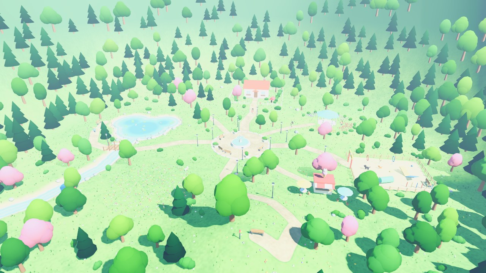
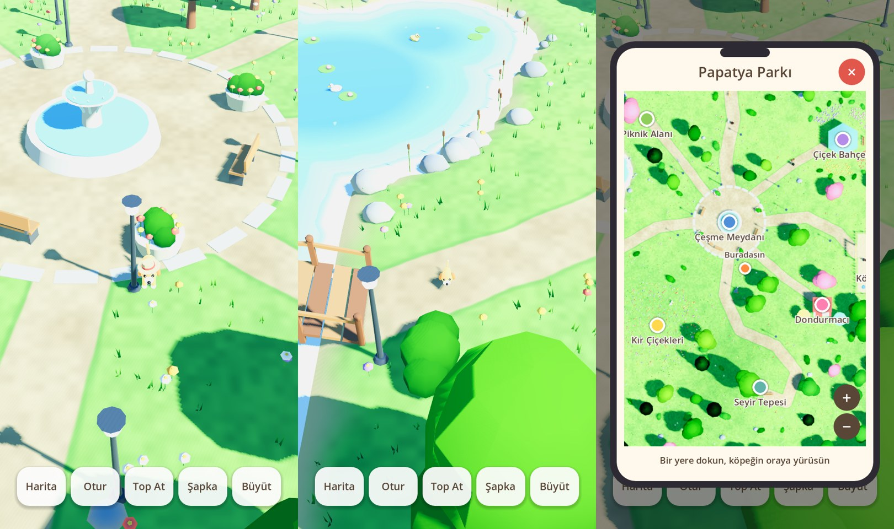

# Evcil Hayvan Oyunu — Plan

## Güncel durum

Kararlar: **Godot 4**, ilk hayvan **köpek**, önce **Android**, tamamen **offline** (diğer hayvanlar ve insanlar NPC).

Çalışan ilk sürüm repoda (`project.godot`). Şu an olanlar:

- **Papatya Parkı**: ev ve bahçesi (köpek kulübesi dahil), çeşmeli meydan, gölet ve dere, ahşap köprü, köpek oyun alanı, dondurmacı, çiçek bahçesi, piknik alanı, seyir tepesi, kır çiçeği çayırı.
- Dokunarak yürüme, takip eden kamera, engeller ve su.
- Komutlar: **Otur**, **Top At** (köpek koşup getirir).
- Örnek aksesuar (şapka, tasma) ve üç büyüme evresi.
- Parkta gezen insanlar, onları takip eden ve serbest dolaşan köpekler.
- Telefon görünümlü **harita**: kaydır, yakınlaştır, bir yere dokun, köpek yolları izleyerek oraya gider.

Köpek ve insanlar şimdilik basit şekillerden yapılmış geçici modeller; Tripo modelleri gelince değişecek.

### Çalıştırma

Godot 4.4 ile `project.godot` dosyasını aç, F5'e bas. Harita verisi `scripts/park_map.gd` içinde; yolları değiştirirsen
`godot --headless --path . -s tools/bake_splat.gd` ile zemin boyamasını yeniden üret.

### Sıradaki işler

1. Telefonda deneme: Android çıktısı alıp performansa ve renklere bakmak.
2. Tripo'dan köpek modeli + animasyon denemesi (en büyük risk burada).
3. Ev içi ve arka bahçe: oyuncaklar, mama kabı, besleme, ihtiyaç barları.
4. Topu parmakla fırlatma, daha fazla komut (gel, pati ver, yat).
5. Fotoğraf modu: alçak kamera, poz, arayüzsüz ekran görüntüsü.
6. Yeni bölgeler: sahil, kasaba sokağı (kafe, pet shop), orman yolu, göl kenarı. Harita ekranı bölgeler arası geçişi de gösterecek.

### Süre hakkında

İki haftada telefonda oynanan, park + ev + komutlar içeren bir sürüm gerçekçi; kod tarafı hızlı ilerliyor.
Mağazaya çıkacak kalite için belirleyici olan kod değil, modeller, animasyonlar ve telefonda test. Tripo çıktıları
ilk denemede iyi çıkarsa süre kısalır, çıkmazsa en çok zaman orada gider.

---

Aşağısı ilk plan; kararların gerekçeleri için duruyor.

Mobil, 3D, sakin tempolu bir evcil hayvan oyunu: hayvanını besle, büyüt, giydir, birlikte parklarda gezintiye çık.

## 1. Temel kararlar

| Konu | Karar | Neden |
|---|---|---|
| Ekran yönü | **Dikey** | Tek elle oynanır; bakım oyunları dikeyde tutuyor. Gezinti, "dokun-yürü" ya da tek joystick ile dikeyde rahat çalışır. |
| Görsel stil | **Stilize low-poly / chibi**, düz renkler, yumuşak ışık | Telefonda akıcı çalışır, AI ile üretilen modellerin kusurlarını gizler, tek kişiyle tutarlı bir görünüm yakalanabilir. Gerçekçi stil bu ekiple tutmaz. |
| Kamera | Sabit açılı, yukarıdan-çapraz takip kamerası | Serbest kamera hem kontrolü zorlaştırır hem her açıdan detay ister. |
| Oyun motoru | **Godot 4** (alternatif: Unity) | Aşağıda. |
| İlk platform | **Android** | iOS için Mac ve yıllık 99 $ geliştirici hesabı gerekir; sonraya bırakılır. |
| Çok oyunculu | **Yok** (ilk sürümde) | Diğer hayvanlar ve insanlar NPC. Online, iş yükünü birkaç katına çıkarır. |

### Motor: Godot mu Unity mi?

- **Godot 4**: Ücretsiz, hafif, sahne dosyaları düz metin. Kodun büyük kısmını Claude bu repoda yazıp test edebilir, Android çıktısı komut satırından alınır. Zayıf yanı: reklam / uygulama içi satın alma eklentileri topluluk işi, hazır asset pazarı küçük.
- **Unity**: Mobilde en olgun seçenek, reklam/IAP ve hazır asset konusunda çok güçlü. Zayıf yanı: sahne ve prefab işleri editörde elle yapılır; yani işin büyük kısmını senin editörde yapman gerekir.

Öneri: Editörde kendin uzun saatler çalışmayı planlamıyorsan **Godot**. Unity tecrüben varsa veya editörde çalışmak istiyorsan Unity.

## 2. Oyun döngüsü

1. **Bakım** (ev): besle, yıka, sev, uyut → açlık / enerji / mutluluk / temizlik barları.
2. **Gezinti** (harita): parka çık, dolaş, eşya ve para topla, diğer hayvanlarla oyna, mini oyun oyna.
3. **Ödül**: para ve bağ puanı → mama, aksesuar, yeni bölge.
4. **Büyüme**: gerçek zamana ve bakım kalitesine bağlı 3 evre (yavru → genç → yetişkin).

Hayvan asla ölmez veya kaçmaz; ihmal edilirse sadece üzülür. Cezalandıran tasarım bu türde oyuncu kaybettirir.

### Fikirler (öncelik sırasıyla)

- **Fotoğraf modu**: manzara + giydirilmiş hayvan = paylaşılabilir görsel. Oyunun bedava reklamı olur.
- **Koleksiyon**: her bölgede bulunacak kartpostal / çıkartma / çiçek; gezmeye sebep verir.
- **Hayvan kişiliği**: oyuncu, uykucu, obur gibi 1-2 özellik; animasyon ve tepkileri değiştirir.
- **Hayvan arkadaşlıkları**: parkta tanışılan NPC hayvanlarla bağ seviyesi, birlikte oyun.
- **Mini oyunlar**: top/frizbi getirme, saklambaç, engel parkuru.
- **Gece-gündüz ve hava durumu**: aynı haritayı ucuza çeşitlendirir.
- **Günlük görevler**: "bugün 2 arkadaşla oyna" gibi küçük hedefler.

## 3. Modelleme: Tripo ile ne olur, ne olmaz

**İyi çalışır**
- Çevre objeleri: ağaç, çiçek, bank, çit, çeşme, ev, köprü. Statik oldukları için en sorunsuz kısım.
- Aksesuarlar: şapka, gözlük, tasma, fular, sırt çantası, patik.
- Hayvanın ana gövdesi (konsept görselden 3D'ye).

**Sorun çıkarır**
- **Topoloji ve poligon sayısı**: çıktılar ağır ve dağınık gelir. Low-poly / retopoloji seçeneği kullanılmalı, gerekirse Blender'da sadeleştirilmeli. Hedef: hayvan 5-15 bin üçgen, obje 0,5-2 bin.
- **Kıyafet gövdeye yapışık gelir**: "kıyafetli köpek" üretirsen kıyafeti çıkaramazsın. Hayvan her zaman çıplak üretilir, aksesuarlar ayrı model olur.
- **Dört ayaklı animasyon**: projenin en büyük teknik riski. Tripo'nun otomatik rig/animasyonu hayvanlarda yeterli olmazsa hazır animasyonlu hayvan paketine (ör. Quaternius, ücretsiz CC0) geçilir. İlk hafta test edilecek.
- **Stil tutarlılığı**: her model farklı tarzda çıkabilir. Çözüm: önce tek bir stil referansı belirle, tüm konsept görselleri o referansla üret, sonra 3D'ye çevir.

Not: Tripo'nun özellikleri ve üyelik limitleri sık değişiyor; rig, low-poly ve dışa aktarma haklarını (ticari kullanım dahil) kendi paketinde kontrol et.

### Üretim hattı

Konsept görsel → Tripo (görselden 3D, low-poly) → Blender'da temizlik (ölçek, merkez noktası, poligon) → rig + animasyon → GLB → oyun motoru.

### Kişiselleştirme tekniği

- **Sert aksesuarlar** (şapka, gözlük, tasma, patik, çanta): iskeletteki kemiğe (baş, boyun, pati) takılır. Kolay, her büyüme evresinde kendiliğinden oturur. İlk sürümün tamamı bu olmalı.
- **Renk / desen**: doku değiştirerek tüy rengi ve deseni. Ucuz ve çok çeşit sağlar.
- **Gövdeyi saran kıyafet** (kazak, mont): gövdeyle birlikte esnemesi gerekir, her model için ayrı el işi ister. Sonraya, az sayıda.

### Büyüme

Üç ayrı model yerine tek model + kemik ölçekleme: yavruda büyük baş, kısa bacak; büyüdükçe oranlar değişir. Tek rig, tek animasyon seti, aksesuarlar hepsine uyar.

### İnsan karakter

Tripo ile değil, **hazır modüler karakter paketi** ile (Quaternius / Kenney ücretsiz, Synty ücretli). Kıyafet değiştirmek için ortak iskelet üzerinde parçalı model gerekir; AI çıktısı bunu vermez. Animasyonlar Mixamo'dan ücretsiz alınır. İlk sürümde kadın/erkek seçimi + birkaç hazır kıyafet yeterli; odak hayvanda kalmalı.

## 4. Aşamalar

**Aşama 0 — Prototip (1-2 hafta).** Tek hayvan Tripo'dan alınır, rig'lenir, küçük bir parkta telefonda yürür. Amaç: üretim hattı çalışıyor mu, görüntü tatmin ediyor mu? Olmuyorsa hazır pakete geçilir.

**Aşama 1 — MVP (4-6 hafta).** Tek tür (köpek), ev + bir park, ihtiyaç barları, besleme/sevme/yıkama, 3 büyüme evresi, 8-10 aksesuar, renk seçimi, kayıt sistemi, çevrimdışı zaman ilerlemesi.

**Aşama 2 — Dünya (6-8 hafta).** İnsan karakter, gezen NPC'ler ve NPC hayvanlar, hayvanlar arası oyun, ikinci bölge (bahçe/sahil), mağaza ve para, 2 mini oyun, fotoğraf modu.

**Aşama 3 — Cila ve yayın (4+ hafta).** Ses ve müzik, öğretici, günlük görevler, koleksiyon, performans, mağaza sayfası, kapalı test, yayın. İkinci tür (kedi) burada eklenir.

Süreler haftada 10-15 saat çalışan tek kişi içindir; gerçekçi toplam 4-6 ay.

## 5. Riskler

1. **Kapsam**: açık harita + NPC + büyüme + giydirme + insan karakter tek kişi için çok. Her aşamanın sonunda oynanabilir bir şey olmalı; sırayı bozmamak şart.
2. **Hayvan animasyonu**: oyunun "canlı" hissi buna bağlı. Yürüme, koşma, oturma, yeme, sevinme, uyuma en az gerekenler.
3. **Performans**: AI modelleri ağırdır; orta sınıf Android'de 60 FPS hedefiyle baştan bütçe tutulmalı.
4. **Gelir modeli**: kozmetik satışı + isteğe bağlı ödüllü reklam bu türe en uygunu. Çocuk kitlesi varsa mağaza kuralları (reklam, veri) sıkılaşır; hedef yaş baştan belirlenmeli.

## 6. Senden beklenen kararlar

1. Godot mu, Unity mi? (Oyun geliştirme tecrüben ve editörde ne kadar çalışmak istediğin belirler.)
2. İlk hayvan türü: köpek mi, kedi mi?
3. Sadece Android ile başlamak uygun mu?
