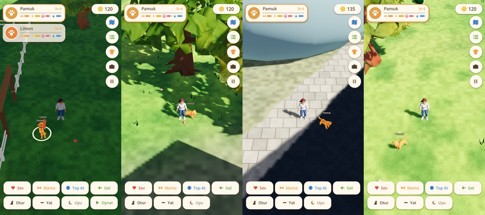
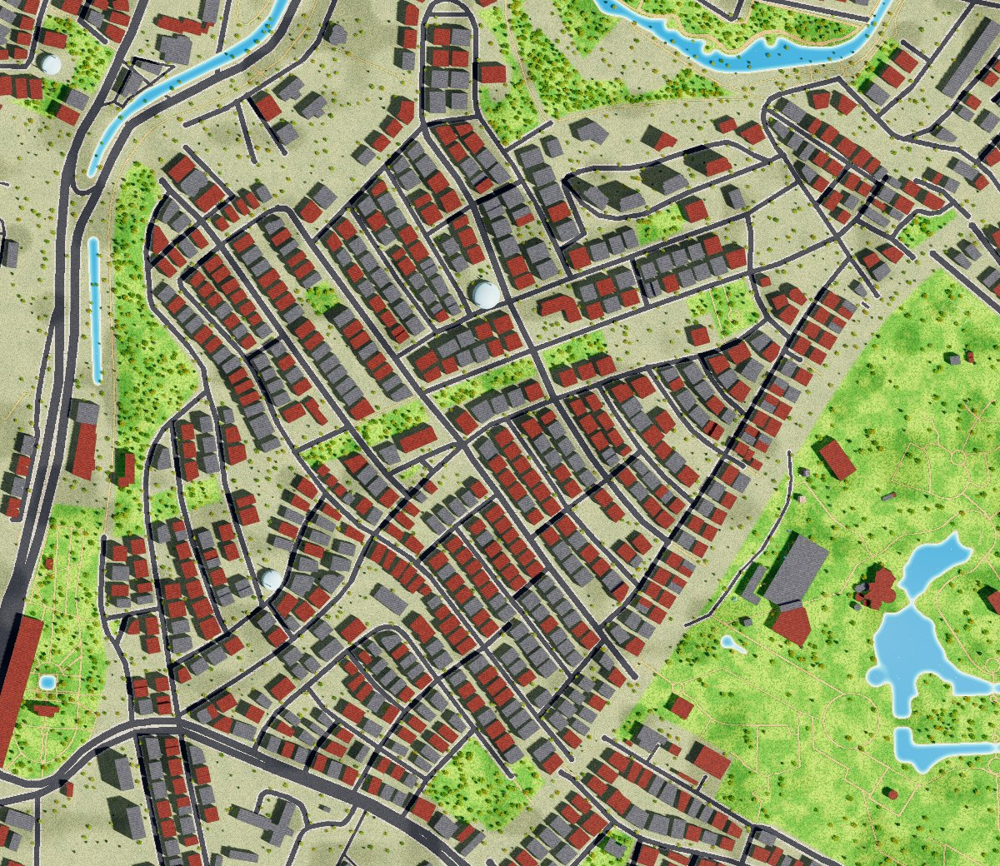
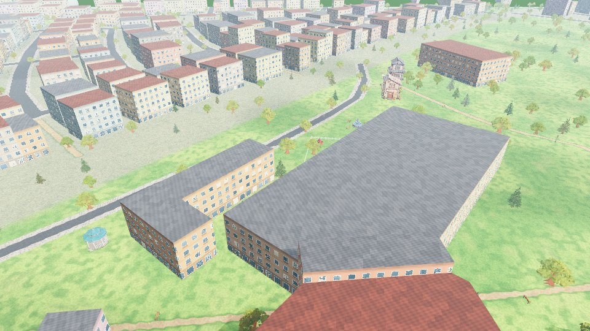

# Patili Gezinti

Mobil (dikey), 3D, sakin tempolu bir evcil hayvan oyunu. Sahip karakterinle Ankara Keçiören'deki Kavacık Subayevleri Mahallesi'nde dolaşırsın; köpeğin ve kedin seni takip eder,
komutlarını dinler, oyun oynar, büyür. Godot 4.4 ile yazıldı, tamamen çevrimdışı çalışır.





## Çalıştırma

Godot 4.4 ile `project.godot` dosyasını aç ve F5'e bas. Fareyle tıklamak dokunmanın yerini tutar, tekerlek yakınlaştırır.

Android için: Godot'da *Editor → Manage Export Templates* ile şablonları indir, Android SDK yolunu ayarla,
*Project → Export → Android* ile APK al (hazır ayar `export_presets.cfg` içinde).

## Oyunda neler var

- **Karakterler:** kadın ya da erkek sahip; köpek ve/veya kedi. İkinci hayvan Pet Shop'tan sahiplenilir.
- **Harita: gerçek Kavacık Subayevleri Mahallesi (Keçiören).** Yaklaşık 1300 × 1120 metre: Subayevleri merkezinden Kavacık tarafına
  tüm sokaklar (Fatih Caddesi, Fahrettin Altay Caddesi, Kavacık Sokak ve 46 sokak daha), 1.100 bina, Kavacık Subayevleri Camii, okullar,
  Hulusi Sayın ve Ahmet Önder parkları, Çubuk Çayı, Atatürk Botanik Bahçesi ve Altınpark'ın göletli batı bölümü. Hepsi OpenStreetMap
  verisinden gerçek konum ve ölçüleriyle üretilir (aşağıda).
- **Oyun için eklenen yerler** (gerçekte yok, Altınpark'taki boş çimlere yerleştirildi): hayvan bahçesi (kulübe, havuz, oyuncaklar),
  Pet Shop, kafe, dondurmacı, çardak, çeşme, köpek oyun alanı, piknik alanı.
- **Komutlar:** Sev, Mama, Top At (köpek koşar, havada yakalayabilir), Yumak (kedi), Gel, Otur, Yat, Uyu, Oynat (iki hayvan kovalamaca oynar).
  Yerdeki bir oyuncağın yanındaysan top yerine o atılır.
- **İhtiyaçlar:** tokluk, enerji, neşe, temizlik. Oyun kapalıyken de azalır (sınırlı). Havuzda yıkanır, kulübede uyur.
- **Büyüme:** hayvan seviye atladıkça yavru → genç → yetişkin olur (3. ve 6. seviye).
- **Aksesuar:** şapka, gözlük, tasma/fular/papyon, patik, sırt çantası/pelerin. Dolaptan giydirilir.
- **Harita:** telefon uygulaması görünümünde; kaydır, yakınlaştır, yer seç, "Yürü" de.
- **Altın:** yollardaki altınlar, oyunlar, günlük görevler, yeni yer keşfi ve seviye atlamadan kazanılır.
- **Fotoğraf modu:** kamerayı çevir, poz verdir, çek. `user://fotolar` klasörüne (telefonda Resimler/PatiliGezinti'ye de) kaydeder.
- **NPC'ler:** yürüyen insanlar, onları izleyen hayvanlar, serbest gezen köpekler, kovalamaca oynayan kediler. "Arkadaşıyla Oynat" ile katılabilirsin.

## Harita nasıl üretildi

Veri: (c) OpenStreetMap katkıcıları, ODbL lisansı. Ham veri `data/subayevleri.osm` içinde (`tools/osm_clip.py` ile kırpıldı).

```bash
python3 tools/osm_build.py data/subayevleri.osm
```

Bu komut `assets/city.json` (yollar, binalar, parklar, yer adları), zemin boyama dokularını ve harita uygulamasındaki görseli üretir.
Başka bir bölge için `tools/osm_build.py` içindeki `CENTER` (enlem, boylam) ve `HALF` (yarı boyut, metre) değerlerini değiştirmek,
o bölgenin `.osm` dosyasını indirmek ve `WANTED` içindeki oyun yerlerinin istenen konumlarını vermek yeterli (araç en yakın boş park çimini kendi bulur).

Sınırlar: bina yükseklikleri veride yok, kat sayısı taban alanına göre tahmin ediliyor; cepheler gerçek binalara benzemez, hepsi aynı
apartman stilinde çizilir. Arazi düz kabul edildi (mahallenin gerçek eğimi yok). Araç trafiği yok.

## Modeller nasıl üretildi

Köpek, kedi, iki insan, ev, kulübe, ağaçlar, çeşme, bank, lamba, dondurmacı, çardak, pet shop ve kafe Tripo ile üretildi
(`docs/tripo-modeller.jpg`). Araçlar `tools/` klasöründe:

| Araç | İş |
|---|---|
| `optimize_glb.py` | Modeli telefona uygun hale getirir: yalnızca renk dokusu, 1024 px |
| `decimate_glb.py` | Üçgen sayısını düşürür (çok kullanılan ağaç, ev, lamba, bank için) |
| `rig_pet.py` + `rig_pets.json` | Modele iskelet takar: kemikler elle yerleştirilir, ağırlıklar mesafeye göre hesaplanır |
| `osm_build.py` | OpenStreetMap verisini oyun haritasına çevirir |

Tripo'nun otomatik iskeleti dört ayaklı modelde bozuk çıktığı için kullanılmadı. Hayvan ve insan hareketlerinin tamamı kodla
üretiliyor (`scripts/pet_model.gd`, `scripts/person_model.gd`); hazır animasyon dosyası yok. Yeni bir hareket eklemek kod yazmak demek.

Yeni bir hayvan türü eklemek için: Tripo'da düz duran, bacakları ayrık bir model üret → `rig_pets.json` içine kemik konumlarını yaz →
`rig_pet.py` ve `optimize_glb.py` çalıştır → `pet_model.gd` içindeki `KINDS` tablosuna ekle.

## Kod yapısı

| Dosya | İş |
|---|---|
| `scripts/main.gd` | Giriş: sahne kurulumu, girdi, kamera, komutlar, ödüller |
| `scripts/park_map.gd` | Harita verisini yükler: sokak ağı, gölet, sınırlar, rota bulma |
| `scripts/world.gd` | Haritayı 3D sahneye çevirir: zemin, gölet, apartmanlar, parklar, eklenen yerler |
| `scripts/pet_agent.gd` | Hayvan davranışı: takip, komutlar, top getirme, oyun, uyku, yıkanma |
| `scripts/pet_model.gd`, `person_model.gd` | İskeletli modeller ve kodla üretilen hareketler |
| `scripts/game_state.gd` | Kalıcı durum: para, mama, aksesuar, ihtiyaçlar, görevler, kayıt |
| `scripts/ui.gd`, `map_screen.gd`, `ui_kit.gd`, `icon.gd` | Arayüz, harita uygulaması, kodla çizilen simgeler |
| `scripts/accessories.gd` | Aksesuar kataloğu ve modelleri |

## Bilinen eksikler

- **Telefonda denenmedi.** Buradaki ekran görüntüleri yazılımsal çizimle alındı; telefonda renkler ve hız farklı olabilir.
- **Ses yok.** Müzik ve efekt eklenmedi.
- **Yol bulma basit.** Dokunarak yürürken karakter düz gider, engele takılabilir; haritadan "Yürü" ise yolları izler.
- **Sokaklar sade.** Binalar arasında araç, tabela, dükkân vitrini gibi ayrıntılar yok.
- **Hareketler kodla üretildiği için** hazır animasyonlar kadar akıcı değil; özellikle insan yürüyüşü geliştirilebilir.
- **Ev yok.** Hayvanların bahçesi parkın içinde; oyuncunun evi tanımlı değil.
- Fotoğraflar telefonda galeriye düşmeyebilir (depolama izni gerekir).

## Hazır APK

`apk/patili-gezinti.apk` (Android, arm64, hata ayıklama imzalı). Telefona indirip kurmak için "bilinmeyen kaynaklardan yükleme"ye
izin vermek gerekir. Mağazaya yüklemek için ayrıca yayın imzasıyla dışa aktarmak gerekir.
